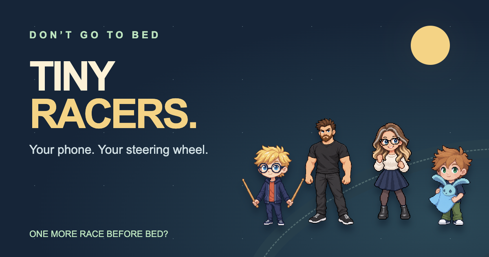

# Don't Go To Bed: Tiny Racers

Local racing for one to four players, with phones and tablets as steering wheels.
Play solo or add up to three computer opponents (four racers total).
Android TV emulator host, browser motion controllers, original family characters.
Hackathon preview 0.2.0 — not an Appstore release.

## Play the demo

[Watch the narrated demo](https://www.youtube.com/watch?v=QCKjIHIIFqA).
Install [the demo APK](artifacts/tiny-racers-0.2.0-hackathon.apk) on an Android TV
emulator, launch it and wait for ONLINE. Scan the TV QR with Android Chrome or
iPad Safari, lock screen rotation, tap Ready and hold your device still to calibrate.
Choose a track, laps and optional bots, then start the race.

Internet is required. No Mac bridge or custom certificate is needed for the default
hosted connection. Safari needs motion permission; restricted devices may need
parental website approval. The APK is debug-signed for testing, not an Appstore release.

[Setup and source builds](JUDGE_SETUP.md) · [Hosted pairing](submission/HOSTED_SETUP.md)

## Licence

Original code and technical documentation are [MIT-licensed](LICENSE), including
commercial use. Characters, recordings, promotional artwork and branding have
[separate asset terms](ASSET_LICENSE.md). Third-party music and dependencies retain
their own licences; see [credits](CREDITS.md). The complete branded game is not
licensed as an unrestricted asset collection. See [contributing](CONTRIBUTING.md).

## Current game
- Up to four players: Leo, Ian, Daddy and Mammy, with top-down racer artwork.
- Three courses: Dining Table, Garden and Bedroom, with hairpins and shortcuts.
- Shared camera: fall behind and you're eliminated. Last survivor earns a point;
  everyone returns near the winner. Choose 1–3 laps in the lobby; final standings follow the selected distance.
- Full-screen track with small character/name/score badges.
- Bumper contact, solid themed obstacles, table-edge falls, narrow/full ramps,
  landing damage and randomized booster pads.
- Six items: boost, toy ball, oil, wooden mallet, extending boxing glove and grabber.
  Automatic use is on by default; manual mode is available in Pause.
- One-button readiness; motion calibration, inversion and sensitivity 50–200%.
- Shared pause identifies its owner. Owner can resume; departure releases pause.
  TV Menu can pause/resume; in the lobby it opens music/effects volume settings.
- Local music and effects, with asset credits/provenance retained.

Three complete four-car simulation laps measured approximately 213 seconds
(Dining), 198 seconds (Garden) and 211 seconds (Bedroom). These are synthetic
test results, not measurements of tonight's iPad play.

## Architecture and current limitations
Phone Safari/Chrome → HTTPS/WSS Cloudflare relay → Android TV app.
The TV host owns the simulation, pickups, collisions, weapons and scores.
The default build connects directly to the hosted relay. No Mac bridge, ADB forwarding or custom certificate is needed. Internet and available Workers Free quota are required. See [hosted setup](submission/HOSTED_SETUP.md) and [capacity limits](relay/README.md). Physical Fire TV testing is still pending.

Character artwork is shared with the original Don't Go To Bed game. Code-drawn track environments
take inspiration from user-supplied photos; photos are not shipped in the app.
Character references come from the main original game resources. Mammy uses
Mammy C. Runtime asset notices and source provenance are retained.

## Build and check
See JUDGE_SETUP.md for prerequisites and commands.
- Android: assembleDebug and lintDebug.
- Controller: npm --prefix spike test.
- Java: RaceModelCheck, TracksAndGrabberCheck and LapsAndCameraCheck cover complete circuits, repeated lap features, camera catch-up and rules.
- scripts/check-launcher.py exercises startup/reuse/cleanup using fake devices.
- scripts/check-package.py validates a clean exported source build.
- spike/check-ready-flow.mjs uses a fake host and synthetic motion in a browser.
  This checks UX logic, not physical iOS permission behaviour.
- Host/browser integration scripts require a running emulator and dedicated Chrome
  on port 9225. Do not run them during family games; they occupy player slots.

Android Chrome and iPad Safari have been confirmed working with the hosted
controller. Emulator checks also cover four synthetic controllers and reconnection.
Physical Fire TV performance and four-device physical coverage are not claimed.

## Source package

Build the APK, then run `python3 scripts/package-demo.py` to prepare a local source
archive and checksums. The output retains its historical `tiny-racers-private-review.zip`
filename; the code and asset licences above govern its contents. It includes the
APK and required artwork; raw MP3s are restored locally from the APK for personal
builds. Packaging does not upload anything.

## Next

Direct phone-to-TV WebRTC is the first task after hackathon submission. Physical
Fire TV testing and further controller refinement remain ahead. Eight-player mode
is deferred. The shared hosted relay has a daily free allowance; forks should
[deploy their own relay](relay/README.md) for sustained use.

## Languages
Player-facing controller and TV text supports en/de/fr/es/it/pt/nl/pl. Controllers
use the browser language (English fallback) and a persistent language picker.
Options → TV language changes the shared display and persists on the host.
`locales/player-ui.tsv` is the shared source; run `python3 scripts/build-locales.py`
after editing it. `spike/i18n.test.mjs` validates key and placeholder coverage.
Developer diagnostics, certificate setup instructions and media credits remain
English. Translations have automated/layout checks, not native-speaker sign-off.

## Hackathon media and credits

[Marketing pack](marketing/README.md): voiceover scripts, video edit recipes,
thumbnails and social graphics. [Credits and asset terms](CREDITS.md).
[Language documentation](locales/README.md) describes coverage and validation.
The judge APK is in artifacts/; no standalone third-party audio files are distributed.
